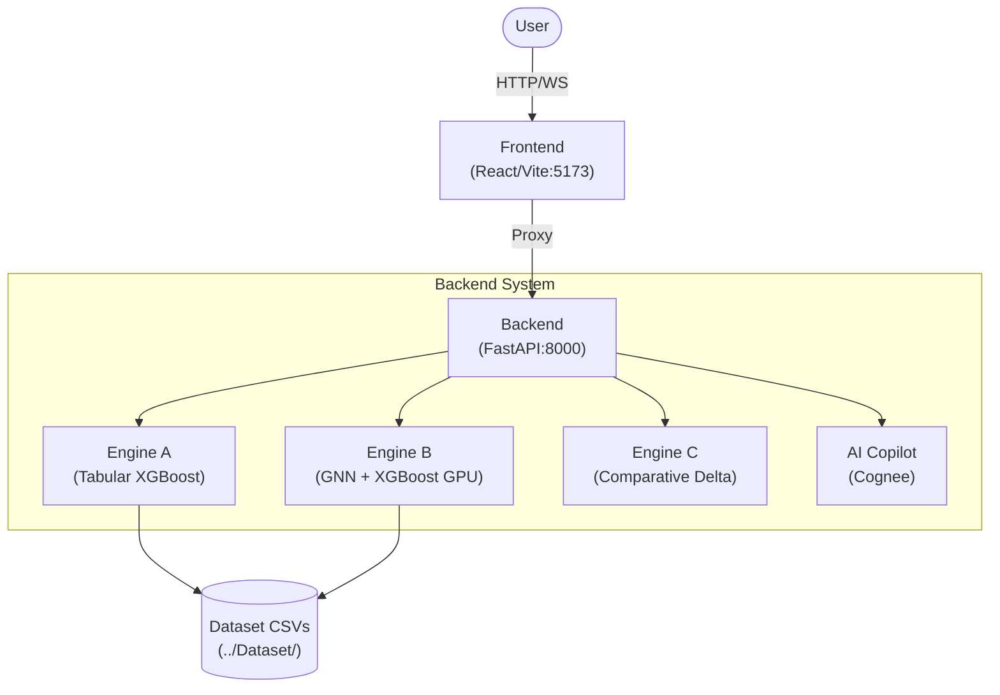

# Unified Credit Scoring Engine

The Unified Credit Scoring Engine is an advanced, full-stack application designed to compare traditional tabular machine learning models with next-generation hybrid Graph Neural Network (GNN) approaches for credit risk assessment.

## Features

- **Backend**: FastAPI (Python 3.12+), running on port 8000
  - **Engine A**: Legacy Tabular XGBoost (11 features)
  - **Engine B**: Hybrid GNN + XGBoost (52+ features, CUDA GPU-accelerated with PyTorch Geometric)
  - **Engine C**: Comparative Delta Analysis (head-to-head A vs B)
  - **AI Copilot**: Cognee-powered natural language Q&A
  - WebSocket live metrics at `/ws/live-metrics`
  - CSV upload at `POST /api/upload`
- **Frontend**: React 19 + Vite 8 + Tailwind CSS v4
  - 3D network visualization (Three.js/react-force-graph-3d)
  - Real-time dashboard with Recharts
  - Light/Dark theme toggle
  - Engine A/B/C toggle with live comparison

## Architecture



## Prerequisites

- Python 3.12+
- Node.js 20+
- CUDA GPU (recommended for Engine B, falls back to CPU)
- Dataset CSVs in `../Dataset/` (relative to `unified-credit-app/`)

## Quick Start

You can start the application using individual commands or with Make.

### Manual Setup

```bash
# 1. Clone and navigate
cd unified-credit-app

# 2. Install backend
cd backend
python -m venv .venv
# Windows
.venv\Scripts\activate
# macOS/Linux
source .venv/bin/activate
pip install -r requirements.txt

# 3. Install frontend
cd ../frontend
npm install

# 4. Configure environment
cd ..
cp .env.example .env
# Edit .env if needed

# 5. Start backend (from backend/)
cd backend
python -u main.py
# Server at http://localhost:8000

# 6. Start frontend (from frontend/ in new terminal)
cd frontend
npm run dev
# App at http://localhost:5173
```

### Using Make

```bash
make install
make backend  # terminal 1
make frontend # terminal 2
```

## Dataset Schema

The system requires CSV datasets with the following schema:

| Column | Type | Description |
|--------|------|-------------|
| Customer_ID | string | Unique identifier |
| Target_Default | int (0/1) | Default label |
| Age | float | Borrower age |
| Verified_Monthly_Income | float | Verified income |
| Debt_to_Income_Ratio | float | DTI ratio |
| Loan_Amount | float | Loan size |
| CIBIL_Score | float | Credit score |
| Utility_Payment_Consistency | float | Utility payment reliability |
| Loan_Term_Months | float | Duration of the loan |
| Interest_Rate | float | Interest rate of the loan |
| Num_Past_Defaults | float | Number of prior defaults |
| Num_Active_Loans | float | Number of currently active loans |
| Credit_History_Months | float | Length of credit history |
| Savings_Balance | float | Balance in savings accounts |
| EMI_Bounce_Count | float | Number of bounced EMIs |
| Credit_Utilization_Pct | float | Percentage of available credit used |
| Salary_Deposit_Regularity | float | Regularity of salary deposits |

**Fraud / Entity Edge Columns (Required for Engine B Graph Construction):**
- `Customer_ID`
- `Device_ID`
- `IP_Address`
- `UPI_VPA`
- `Loan_Purpose`

## API Reference

| Method | Endpoint | Description |
|--------|----------|-------------|
| GET | `/` | Health check |
| GET | `/api/engine/{a\|b\|c}/metrics` | Engine metrics |
| GET | `/api/engine/{a\|b}/features` | Feature importance |
| GET | `/api/engine/{a\|b}/roc` | ROC curve |
| GET | `/api/graph?mode=b` | 3D graph data |
| POST | `/api/upload` | Upload CSV dataset |
| POST | `/api/chat` | AI Copilot query |
| WS | `/ws/live-metrics` | Live metrics stream |

## Expected Outputs

Upon successful backend startup and model evaluation, you should observe output similar to:

```
Engine A ROC-AUC: ~0.9970
Engine B ROC-AUC: ~1.0000
Delta:            ~+0.0030
```

## Testing

```bash
# Backend tests
cd backend && python -m pytest tests/ -v

# Frontend build check
cd frontend && npm run build
```

## License

MIT
